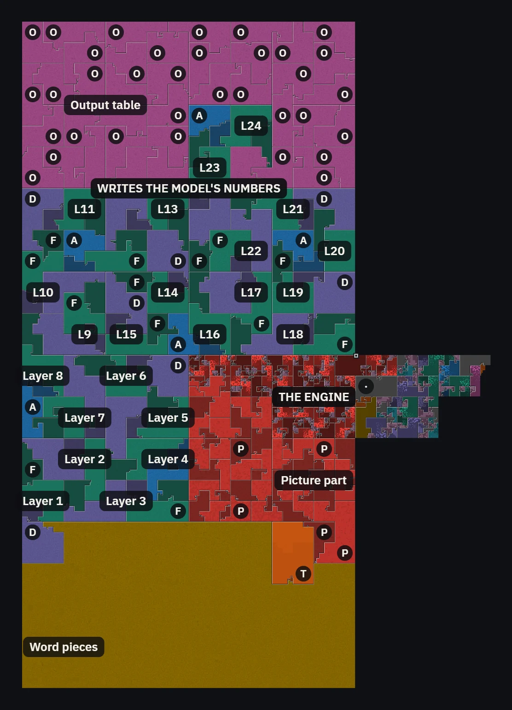
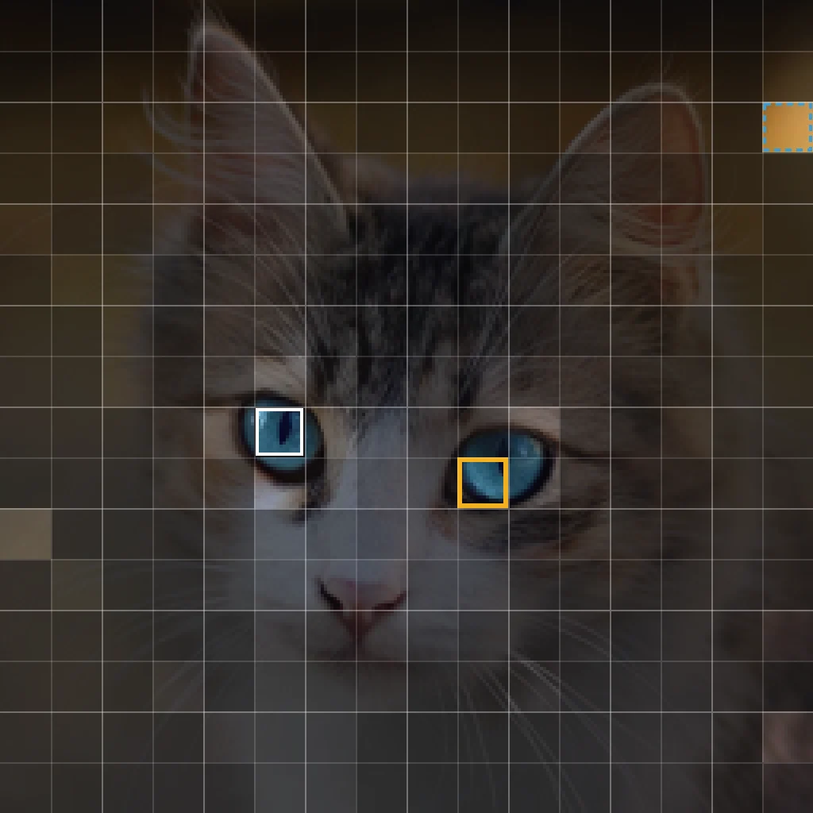
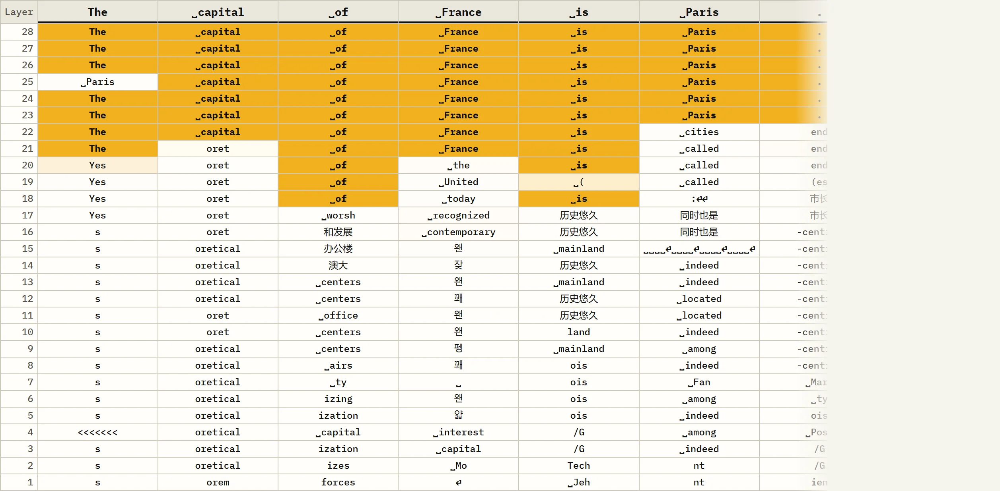
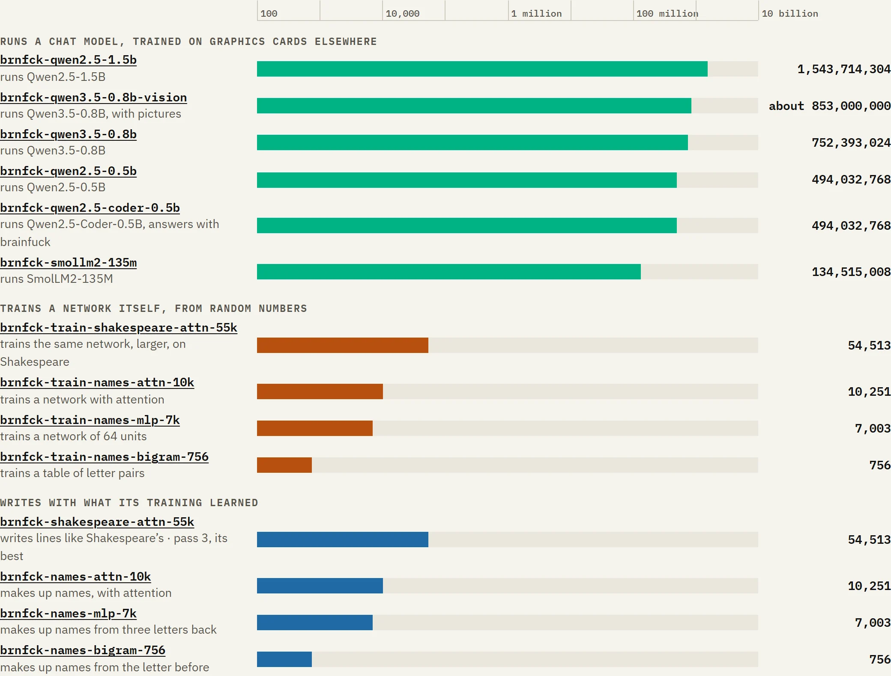
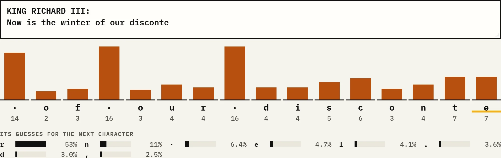
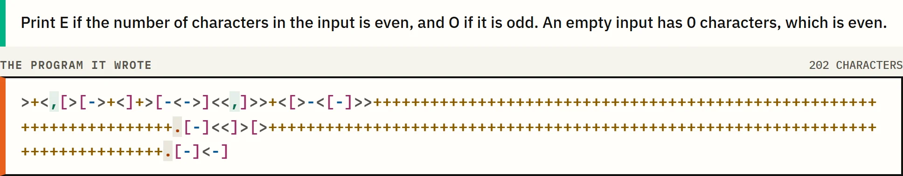

# brnfck.chat

Type a question. A program written in brainfuck prints the answer.

Brainfuck has eight commands. They move along a row of memory cells, change the numbers in them,
and read or print characters. Here those commands run a language model. Each program is one text
file of only `+ - < > [ ] , .`, and its only input is your question. One of them also reads a
picture before the question, and one answers with a brainfuck program of its own.

How that works is on the site: https://brnfck.chat. This page says how to run it yourself.

<table>
<tr>
<td width="42%" rowspan="2" valign="top"><a href="https://brnfck.chat/map/?m=0.8b-vision"></a><br><b>Every character on one map.</b> brnfck-qwen3.5-0.8b-vision: all 8,931,101,427 characters folded into one square. In red, the part that looks at the picture.</td>
<td valign="top"><a href="https://brnfck.chat/vision/"></a><br><b>Where the program looks.</b> The square on the left eye of the cat (white), in layer 4 of 12: after itself and a notepad square, it takes in most from the other eye (yellow).</td>
</tr>
<tr>
<td valign="top"><a href="https://brnfck.chat/how/"></a><br><b>What every layer would say.</b> brnfck-qwen2.5-1.5b answers "What is the capital of France?". Each row is one of its 28 layers; Paris wins from layer 23 on.</td>
</tr>
<tr>
<td width="42%" rowspan="2" valign="top"><a href="https://brnfck.chat/compare/"></a><br><b>Every program at one scale.</b> From 756 weights to 1,543,714,304: the six chat programs, the four that train a network themselves, and the four programs they wrote.</td>
<td valign="top"><a href="https://brnfck.chat/train/"></a><br><b>Shakespeare, trained in brainfuck.</b> brnfck-train-shakespeare-attn-55k learned from random numbers inside brainfuck and printed a child program. Given "Now is the winter of our disconte", the child looks back over 16 characters and guesses r (53%).</td>
</tr>
<tr>
<td valign="top"><a href="https://brnfck.chat/coder/"></a><br><b>Brainfuck that writes brainfuck.</b> Asked in words for even or odd, brnfck-qwen2.5-coder-0.5b printed this program of 202 characters. It passes every test case.</td>
</tr>
</table>

## The six programs

| Program | Runs the model | Characters | Memory to run | Build argument |
|---|---|---|---|---|
| brnfck-smollm2-135m | SmolLM2-135M-Instruct | 1,030,902,380 | about 1.5 GB | `small` |
| brnfck-qwen2.5-0.5b | Qwen2.5-0.5B-Instruct | 4,169,659,608 | about 4 GB | `0.5b` |
| brnfck-qwen2.5-1.5b | Qwen2.5-1.5B-Instruct | 11,430,468,880 | about 8 GB | `1.5b` |
| brnfck-qwen3.5-0.8b | Qwen3.5-0.8B | 7,709,034,855 | about 5 GB | `0.8b` |
| brnfck-qwen3.5-0.8b-vision | Qwen3.5-0.8B with its part for pictures | 8,931,101,427 | about 7 GB | `0.8b-vision` |
| brnfck-qwen2.5-coder-0.5b | Qwen2.5-Coder-0.5B-Instruct, taught to answer in brainfuck | 4,221,469,653 | about 4 GB | `coder-0.5b` |

## What you need

- Node.js 24 and Python 3.12. No packages, no compiler.
- For brnfck-smollm2-135m: about 5.5 GB of free disk space and 3.5 GB of free memory.
- For brnfck-qwen2.5-0.5b: about 16 GB of free disk space and 7 GB of free memory.
- For brnfck-qwen2.5-1.5b: about 27 GB of free disk space and 13 GB of free memory.
- For brnfck-qwen3.5-0.8b: about 13 GB of free disk space and 7 GB of free memory.
- For brnfck-qwen3.5-0.8b-vision: about 15 GB of free disk space and 10 GB of free memory.
- For brnfck-qwen2.5-coder-0.5b: about 22 GB of free disk space, 7 GB of free memory, and for its
  training step an NVIDIA graphics card with 12 GB and PyTorch (step 3).

## 1. Get the code

```
git clone https://github.com/rutgerklamer/brnfck-chat.git
cd brnfck-chat
```

## 2. Download a model

The program is built from the model's own files. Make the folder and put these files in it.

| Folder | Files from |
|---|---|
| `compiler/downloads/smollm2-135m/` | https://huggingface.co/HuggingFaceTB/SmolLM2-135M-Instruct |
| `compiler/downloads/qwen2.5-0.5b/` | https://huggingface.co/Qwen/Qwen2.5-0.5B-Instruct |
| `compiler/downloads/qwen2.5-1.5b/` | https://huggingface.co/Qwen/Qwen2.5-1.5B-Instruct |
| `compiler/downloads/qwen3.5-0.8b/` | https://huggingface.co/Qwen/Qwen3.5-0.8B |
| `compiler/downloads/qwen2.5-coder-0.5b/` | https://huggingface.co/Qwen/Qwen2.5-Coder-0.5B-Instruct |

Each folder needs `config.json`, `model.safetensors`, `tokenizer.json` and `tokenizer_config.json`.
brnfck-qwen3.5-0.8b-vision is built from the folder of Qwen3.5-0.8B as well.
The three Qwen2.5 folders also need `generation_config.json`. For Qwen3.5-0.8B the weights file is
called `model.safetensors-00001-of-00001.safetensors`: save it as `model.safetensors`:

```
mkdir -p compiler/downloads/qwen3.5-0.8b
cd compiler/downloads/qwen3.5-0.8b
curl -L -O https://huggingface.co/Qwen/Qwen3.5-0.8B/resolve/main/config.json
curl -L -o model.safetensors https://huggingface.co/Qwen/Qwen3.5-0.8B/resolve/main/model.safetensors-00001-of-00001.safetensors
curl -L -O https://huggingface.co/Qwen/Qwen3.5-0.8B/resolve/main/tokenizer.json
curl -L -O https://huggingface.co/Qwen/Qwen3.5-0.8B/resolve/main/tokenizer_config.json
cd ../../..
```

The other folders work the same way, for example:

```
mkdir -p compiler/downloads/smollm2-135m
cd compiler/downloads/smollm2-135m
curl -L -O https://huggingface.co/HuggingFaceTB/SmolLM2-135M-Instruct/resolve/main/config.json
curl -L -O https://huggingface.co/HuggingFaceTB/SmolLM2-135M-Instruct/resolve/main/model.safetensors
curl -L -O https://huggingface.co/HuggingFaceTB/SmolLM2-135M-Instruct/resolve/main/tokenizer.json
curl -L -O https://huggingface.co/HuggingFaceTB/SmolLM2-135M-Instruct/resolve/main/tokenizer_config.json
cd ../../..
```

## 3. Build the program

```
node tools/build.js small --dry-run     # checks the files, the memory and the disk; runs nothing
node tools/build.js small               # builds the program and verifies it
```

The build writes `site/programs/brnfck-smollm2-135m.bf`. For `0.5b`, `1.5b`, `0.8b` and `0.8b-vision` it
writes `brnfck-qwen2.5-0.5b.bf`, `brnfck-qwen2.5-1.5b.bf`, `brnfck-qwen3.5-0.8b.bf` and
`brnfck-qwen3.5-0.8b-vision.bf` in the same folder.

For `coder-0.5b` the build first teaches the downloaded model: it writes 60,000 tasks with a
brainfuck program each, runs every program by the checker of the challenges, and trains the model
on them on the graphics card. That step needs PyTorch in the folder `.venv/`:

```
python -m venv .venv
.venv/Scripts/python -m pip install torch --index-url https://download.pytorch.org/whl/cu128
.venv/Scripts/python -m pip install transformers safetensors
node tools/build.js coder-0.5b
```

On Linux or macOS the Python of the folder is `.venv/bin/python`. The build writes
`site/programs/brnfck-qwen2.5-coder-0.5b.bf`. To see how many challenges the taught model solves:

```
node compiler/coder/challenges.js questions
node compiler/coder/spec_ask.js
node compiler/coder/challenges.js judge compiler/coder/out/answers-spec.json
```

The last step verifies the result three ways: the file holds only the eight commands, the memory
it writes equals the memory of the loaded model, and it prints the same text as a plain
whole-number version of the model. Every check it prints must start with `ok`, and the last line
must read `all <n> ok`.

The built programs are also in the folder `bf/` of the Hugging Face dataset
[rutgerklamer/brnfck-chat](https://huggingface.co/datasets/rutgerklamer/brnfck-chat/tree/main/bf).
To download one instead of building it:

```
cd site/programs
curl -L -O https://huggingface.co/datasets/rutgerklamer/brnfck-chat/resolve/main/bf/brnfck-smollm2-135m.bf
curl -L -O https://huggingface.co/datasets/rutgerklamer/brnfck-chat/resolve/main/bf/brnfck-smollm2-135m.meta.json
cd ../..
```

For the others replace `brnfck-smollm2-135m` with `brnfck-qwen2.5-0.5b`, `brnfck-qwen2.5-1.5b`,
`brnfck-qwen3.5-0.8b` or `brnfck-qwen3.5-0.8b-vision`.

On the computer that built these programs (8 cores, 32 GB) the whole run took about 30 minutes
for `small`, 20 for `0.5b`, 50 for `1.5b`, 25 for `0.8b`, 40 for `0.8b-vision`, and for `coder-0.5b` an
hour of training (RTX 5070) and 30 minutes more. Most of that is the verification. `--quick` verifies
with one question, `--no-verify` skips it, and `--from 4` goes on at step 4 after a stop.

## 4. Ask a question

```
node compiler/smollm/pure/ask.js "What is the capital of France?"
node compiler/qwen/program/ask.js --model 0.5b "What is 7 times 8?"
node compiler/qwen/program/ask.js --model 1.5b "What is 12 + 30?"
node compiler/qwen3.5/program/ask.js "Waar ligt Leeuwarden?"
node compiler/qwen3.5/vision/ask.js compiler/qwen3.5/vision/pictures/cat.png "Describe this picture in one sentence."
node compiler/qwen/program/ask.js --model coder-0.5b "Print the input backwards."
```

The lines ask brnfck-smollm2-135m, brnfck-qwen2.5-0.5b, brnfck-qwen2.5-1.5b, brnfck-qwen3.5-0.8b,
brnfck-qwen3.5-0.8b-vision and brnfck-qwen2.5-coder-0.5b. The last one takes a PNG file; it cuts any other size than 256 by 256 pixels to its
middle square and scales that.

## 5. Open the site

```
python tools/serve.py                   # then open http://localhost:8766/
```

The chat on the start page finds the program you built in `site/programs/`. Choose the program
on the right, type a question, and press Ask.

The lessons, the playground, the patterns, the challenges and the reference work without a build.
The pages "Inside the program", "Program map" and "About the project" draw data that is made from
a built program. These commands write it to `site/inside/data/small/` and
`site/inside/data/compare.json`:

```
node --max-old-space-size=4096 tools/map-data/writer.js small
node tools/map-data/sections.js small
node tools/map-data/tiles.js small
node tools/map-data/depth.js small
node tools/map-data/stops.js small
node --max-old-space-size=4096 tools/map-data/trace.js small
node --max-old-space-size=4096 tools/map-data/trace.js small "Why is the sky blue?" sky
node tools/map-data/checks.js small
node tools/map-data/compare.js
```

For brnfck-qwen2.5-0.5b and brnfck-qwen2.5-1.5b, run the same commands with `0.5b` or `1.5b` in place of `small`,
with one trace.js run instead of two:

```
node --max-old-space-size=4096 tools/map-data/trace.js 0.5b
node --max-old-space-size=4096 tools/map-data/trace.js 1.5b "What is 12 + 30?" sum --max 25
```

For brnfck-qwen3.5-0.8b, use `0.8b` and give writer.js, sections.js and trace.js `--max-old-space-size=6144`,
with one trace.js run:

```
node --max-old-space-size=6144 tools/map-data/trace.js 0.8b "What is 12 + 30?" sum --max 25
```

For `1.5b`, give writer.js `--max-old-space-size=6144`. checks.js reads the log of the
verification in step 3, so build without `--quick` and `--no-verify` first.

For brnfck-qwen3.5-0.8b-vision, the Program map needs these:

```
node --max-old-space-size=6144 tools/map-data/writer.js 0.8b-vision
node --max-old-space-size=6144 tools/map-data/sections.js 0.8b-vision
node tools/map-data/tiles.js 0.8b-vision
node tools/map-data/depth.js 0.8b-vision
```

Run compare.js last: it gathers the programs that have data.

The pictures of the start page and of this page (`site/show/`) are taken from the pages themselves, in
Chrome without a window, with the data above:

```
python tools/serve.py 8840      # in a second terminal
node tools/shots.js
```

The four programs of step 7 are on the map too. This command writes their programs to `site/programs/` and their data to
`site/inside/data/train-bigram/`, `train-mlp/`, `train-attn/` and `train-shakespeare/`:

```
node tools/map-data/train.js
```

The figure of the layers on "How it works" runs each program on one question and reads its numbers
after every layer. It writes `site/inside/data/<name>/lens-france.json`:

```
node --expose-gc tools/map-data/lens.js small
node --expose-gc --max-old-space-size=8192 tools/map-data/lens.js 0.5b "What is the capital of France?" france --max 10
node --expose-gc --max-old-space-size=12000 tools/map-data/lens.js 1.5b "What is the capital of France?" france --max 10
node --expose-gc --max-old-space-size=8192 tools/map-data/lens.js 0.8b "What is the capital of France?" france --max 10
```

The page "Looking at a picture" (`site/vision/`) needs brnfck-qwen3.5-0.8b-vision, built in step 3.
These commands write its data to `site/vision/data/`:

```
node compiler/qwen3.5/vision/record.js
node compiler/qwen3.5/vision/verify_pure.js ask 0 1 2 3 4 5
node compiler/qwen3.5/vision/answers.js
```

The page "Compare the models" (`site/compare/`) runs Qwen3.5-0.8B in the browser. Put its files in
`site/models/qwen3.5-0.8b/`:

```
mkdir -p site/models/qwen3.5-0.8b
cd site/models/qwen3.5-0.8b
curl -L -O https://huggingface.co/Qwen/Qwen3.5-0.8B/resolve/main/config.json
curl -L -O https://huggingface.co/Qwen/Qwen3.5-0.8B/resolve/main/tokenizer.json
curl -L -o model.safetensors https://huggingface.co/Qwen/Qwen3.5-0.8B/resolve/main/model.safetensors-00001-of-00001.safetensors
cd ../../..
```

The page runs `site/compare/live/float.js` and `site/compare/live/deltanet.js`, copies of the files in
`compiler/qwen3.5/`. After a change there, run `node tools/site-qwen3.5.js`.

Every program of the site is in `site/registry.json`, with every version it has had: "Compare the models" shows
them all at one scale. After building a program, changing a generator or a pass of a
long training run, add what is new:

```
node tools/registry.js
```

It keeps every program and version it has seen, adds the new ones, and ends with the pages a program still lacks.

## 6. Put it on a web host

The site is plain files: upload the folder `site/`, with the data of step 5. Leave out
`site/programs/`. Those files are gigabytes, and a visitor's browser reads the program as small
compressed pieces instead:

```
node tools/make-chunks.js small                   # writes site/dist/small/
node tools/make-chunks.js 0.5b                    # writes site/dist/0.5b/
node tools/make-chunks.js 1.5b --chunk 16777216   # writes site/dist/1.5b/, in pieces of 16 MiB
node tools/make-chunks.js 0.8b --chunk 16777216   # writes site/dist/0.8b/, in pieces of 16 MiB
node tools/make-chunks.js 0.8b-vision --chunk 16777216   # writes site/dist/0.8b-vision/
node tools/make-chunks.js verify small            # reads them back; must print "ok"
```

`node tools/make-chunks.js single small` adds the whole program as one compressed file, which the
start page offers as a download.

`site/program-hosts.json` says where each program's pieces are. An empty value means
`dist/<name>/` on the site itself. An address means another host, which must allow other sites to
read from it. `site/inside/data-hosts.json` does the same for the data of step 5.

For the page "Compare the models", upload `site/models/` as well. The host sends the paths `/compare/`
and `/models/` with the headers `Cross-Origin-Opener-Policy: same-origin` and
`Cross-Origin-Embedder-Policy: credentialless`, and sends `model.safetensors` in byte ranges and
uncompressed. `tools/serve.py` does both.

## 7. Train a network inside brainfuck

These programs train a network themselves, from random weights. A training program reads a list of
names through `,`, learns from them, prints its loss after every step and at the end prints a second
brainfuck program, the child: the trained weights and an engine that makes up new names.

| Model | Network | Parameters | Training program | Build argument |
|---|---|---|---|---|
| brnfck-names-bigram-756 | the next letter from the last letter | 756 | brnfck-train-names-bigram-756 | `bigram` |
| brnfck-names-mlp-7k | the next letter from the last three, 64 hidden units, momentum | 7,003 | brnfck-train-names-mlp-7k | `mlp` |
| brnfck-names-attn-10k | the same, plus one attention head over the last eight letters | 10,251 | brnfck-train-names-attn-10k | `attn` |

```
node compiler/train/test-kernels.js    # the building blocks against what they mean in JavaScript
node tools/train.js                    # builds, runs and checks the three models
node tools/train.js attn               # one model: bigram, mlp or attn
node tools/train.js mlp --every 1      # prints the loss of every step (the default is every 50th)
```

Every check it prints must start with `ok`, and for each model it ends with `all ok` and the names
the child printed. It writes to `compiler/train/out/`:

| File | What it is |
|---|---|
| `brnfck-train-names-mlp-7k.bf` | the training program |
| `brnfck-train-names-mlp-7k.input` | its input: the names of `compiler/train/data/names.txt`, shuffled for every epoch |
| `brnfck-names-mlp-7k.bf` | the child it printed |
| `brnfck-names-mlp-7k.txt` | the log: sizes, time, the loss of every step, the names |

To run a program on its own (any brainfuck interpreter with 32-bit wrapping cells, where `,` gives 0
at the end of the input, runs them the same way):

```
node compiler/train/run.js compiler/train/out/brnfck-train-names-mlp-7k.bf compiler/train/out/brnfck-train-names-mlp-7k.input
node compiler/train/run.js compiler/train/out/brnfck-names-mlp-7k.bf
```

### A training program that prints its next generation

This training program prints its own next generation instead of a child. gen0 trains on what it reads,
then prints gen1: the same program, with the weights, velocities, step and context it ended with
written in. Run gen1 on more text and it goes on training from there, then prints gen2. A generation
that is fed nothing prints the child. Everything a generation prints is the next program: its loss
lines come first, inside `[ ]`, a loop that the next program skips.

```
node tools/train-self.js                         # bigram, mlp and attn, in 3 generations each
node tools/train-self.js attn --generations 5    # one model, in 5 generations
```

Each generation trains on its part of the text. Every line, every printed generation and the child are
checked against the reference. The child of the last generation must equal the child of a single run
over the whole text. The tool writes to `compiler/train/out/`:

| File | What it is |
|---|---|
| `brnfck-train-names-mlp-7k-gen0.bf` | gen0, from the generator |
| `brnfck-train-names-mlp-7k-gen1.bf`, `-gen2.bf`, `-gen3.bf` | the generations, each printed by the one before |
| `brnfck-train-names-mlp-7k-generations.txt` | the log |

To go on by hand: run a generation on text to get the next one, or on nothing to get the child:

```
node compiler/train/run.js compiler/train/out/brnfck-train-names-mlp-7k-gen3.bf compiler/train/out/brnfck-train-names-mlp-7k.input > gen4.bf
node compiler/train/run.js gen4.bf > child.bf
node compiler/train/run.js child.bf
```

### Shakespeare, in a long run

brnfck-train-shakespeare-attn-55k trains the same kind of network, larger, on Shakespeare:
`compiler/train/data/shakespeare.txt` (Tiny Shakespeare, from
https://github.com/karpathy/char-rnn/tree/master/data/tinyshakespeare). 54,513 weights; it learns from the
first 90% of the text, and the last 10% measures how well it does on text it never saw. It runs in 19
passes over the text, about 52 minutes each, so about 16.5 hours on one core, with the reference on a
second core:

```
node tools/train-long.js shakespeare            # starts, or goes on after the last finished pass
node tools/train-long.js shakespeare --status   # what is done so far
```

After every pass the tape is saved, and every line, weight and velocity is compared with the reference.
When the run stops (the computer restarts, or Ctrl+C), the same command goes on at the start of the pass
that was running. Every pass leaves in `compiler/train/out/long/brnfck-shakespeare-attn-55k/`:

| File | What it is |
|---|---|
| `pass-NN.bf` | the child program this pass printed |
| `pass-NN.sample.txt` | the 40 lines that child wrote |
| `pass-NN.tape`, `pass-NN.json` | the tape and the state of the reference, for going on (the last two passes are kept) |
| `log.txt` | everything the run printed |

The summary, with the loss of every pass and what each child wrote, is in
`compiler/train/out/brnfck-shakespeare-attn-55k.txt`. To run the last child on its own:

```
node compiler/train/run.js compiler/train/out/long/brnfck-shakespeare-attn-55k/pass-19.bf
```

To show the run on the page "Trained in brainfuck" (the loss, what every pass wrote, and the child of each pass to run in the browser), during the run or after it:

```
node tools/site-shakespeare.js
```

It writes `site/train/data/shakespeare.json` and the weights of every pass's child in `site/train/data/shakespeare/`.

The page "Trained in brainfuck" (`site/train/`) builds and runs these programs in the browser. It
needs `site/train/lib.js` and the data in `site/train/data/`. After a change in `compiler/train/`, run:

```
node tools/site-train.js
```

## Folders

| Folder | What is in it |
|---|---|
| `site/` | the web site |
| `compiler/` | the generators that write a model out as brainfuck, and the scripts that verify the result |
| `tools/` | build, pieces for a web host, data for the map, the pages of the code patterns, the local server |

The pages in `site/patterns/` are written from `site/patterns/data.js`. After a change there, run
`node tools/build-patterns.js`.

## Licence

The code and the site are MIT licensed: see `LICENSE`. The built programs, the `calib.json` files, the
recordings in `site/compare/data/` and the data in `site/vision/data/` hold values of the models, so the models' licence, Apache 2.0, applies to them: see `NOTICE` and
`LICENSES/Apache-2.0.txt`. `tools/make-chunks.js` puts both next to every program it splits.

## Credits

- SmolLM2-135M-Instruct by Hugging Face (HuggingFaceTB), Apache 2.0.
- Qwen2.5-0.5B-Instruct and Qwen2.5-1.5B-Instruct by Alibaba Cloud, Apache 2.0.
- Qwen3.5-0.8B by the Qwen team of Alibaba Cloud, Apache 2.0.
- The photos in `compiler/qwen3.5/vision/pictures/` and `site/vision/pictures/` are from Wikimedia Commons, released
  into the public domain (CC0): see `NOTICE`.
- Brainfuck was designed by Urban Müller in 1993.
